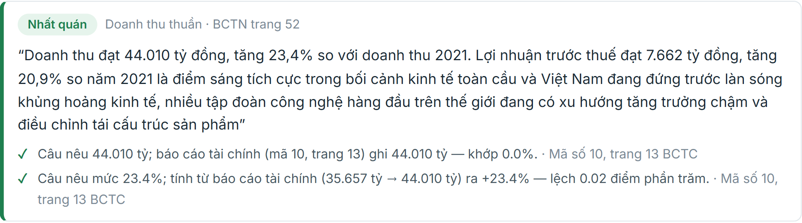

<!--
Mục 03 báo cáo Vòng 2 (mẫu BTC: "03 / TIÊU CHÍ 1 — 20%"). Bản cắt 19/11/2026, Nguyên chốt.
Giới hạn: ≤ 550 từ ngoài bảng + 1 bảng. ⟦CHỜ: …⟧ = số chưa đo. Quyết định nghiệp vụ: docs/gan-nhan/quyet-dinh-nghiep-vu.md.
-->

# 1. Mức độ làm rõ và xử lý bài toán thực tiễn | Trọng số 20%

## 1.1. Bối cảnh và đối tượng sử dụng

Hằng năm, doanh nghiệp niêm yết công bố **BCTC đã kiểm toán** (bảng số theo Thông tư 200, mỗi khoản mục một Mã số) và **báo cáo thường niên (BCTN)** bằng văn xuôi. Kiểm toán viên (đọc "thông tin khác" theo VSA 720), cán bộ giám sát của UBCKNN và Sở giao dịch, chuyên viên phân tích đang đối chiếu tay hai tài liệu này. Năm 2025, UBCKNN ra 194 quyết định xử phạt, hơn 53 tỷ đồng; gần 68% hành vi bị xử lý là lỗi công bố thông tin (Vietstock, 19/12/2025).

Ví dụ: BCTN Vinamilk 2024 tr.31 ghi *"tổng doanh thu hợp nhất 61.824 tỷ đồng, +2,2%"*, khớp Mã 01 chứ không phải Mã 10; cùng trang, câu *"doanh thu và lợi nhuận tăng lần lượt 7,6% và 48,4%"* là của công ty con Angkormilk, ghép từ cột bên.

## 1.2. Phân tích nguyên nhân, tác động và yêu cầu

**Nguyên nhân:** văn xuôi dàn nhiều cột; một chữ nhiều nghĩa ("tổng doanh thu" là Mã 01 ở VNM, Mã 10 + 21 + 31 ở GAS; vòng quay tồn kho tính trên tồn kho bình quân hay cuối kỳ tuỳ doanh nghiệp); số hợp nhất, công ty mẹ, công ty con xen nhau; khoảng 702 doanh nghiệp niêm yết.

**Tác động** (ACFE 2026): gian lận BCTC chỉ chiếm 6% số vụ nhưng thiệt hại trung vị cao nhất (1 triệu USD), và tồn tại trung vị 12 tháng trước khi lộ.

**Yêu cầu:** R1 vết minh chứng tới ô bảng; R2 không cáo buộc oan, precision nhóm "cần xem xét" ≥ 80%; R3 chạy trên máy thường, không gửi dữ liệu ra ngoài; R4 hiểu tiếng Việt và Thông tư 200.

## 1.3. Phát biểu bài toán dữ liệu

- **Đầu vào:** cặp (BCTN năm *t*, BCTC hợp nhất đã kiểm toán năm *t*).
- **Đầu ra:** mỗi khẳng định (câu, trang, chỉ tiêu, hướng, giá trị, kỳ, mốc so sánh) nhận **nhất quán / cần xem xét (lệch với BCTC) / chưa kiểm chứng được**, kèm Mã số, trang BCTC, giá trị hai kỳ và độ lệch.
- **Điều kiện:** chỉ kết luận khi tra được ô cùng phạm vi, kỳ, đơn vị; còn lại nêu lý do.
- **Thước đo:** precision nhóm "cần xem xét" trên 300 cặp có nhãn (mục 2.2); recall trên tập chèn lỗi có kiểm soát, vì mâu thuẫn thật quá hiếm (7/300 cặp) để đo recall ổn định trên dữ liệu thật; tỷ lệ "chưa kiểm chứng được" theo lý do. Kết quả ở mục 3.4.

## 1.4. Các ràng buộc và cách đội đã xử lý

**Bảng 1.1. Ràng buộc thực tế và cách đội xử lý**

| Ràng buộc | Ví dụ thật | Cách xử lý · trạng thái |
|---|---|---|
| Đơn vị tính: khoảng 26% BCTC ghi nghìn hoặc triệu đồng, có mã đổi đơn vị giữa các năm | MSN, VHM, VIC 2020–2024 triệu đồng; HAG nghìn đồng; VIC 2018 ghi đồng | Đọc dòng "Đơn vị tính" của từng báo cáo, quy về đồng · **đã xử lý**: BCTC có doanh thu "dưới 1.000 tỷ" (dấu hiệu sai đơn vị) giảm từ 36/138 xuống 1/138 |
| Câu về công ty con, một mảng, công ty mẹ | VNM 2024 tr.59 (Angkormilk); VCG 2024 tr.27: LNST 861 tỷ là số công ty mẹ (BCTC riêng 860,6 tỷ) | Lọc trang giới thiệu đơn vị thành viên, tên công ty con, câu "công ty mẹ" · **xử lý một phần**: còn 14/21 cờ trong mẫu là câu phạm vi hẹp |
| Chữ hai, ba cột bị trộn khi bóc PDF | VNM 2024 tr.31 sinh câu ghép không có trong báo cáo | Tách cột; loại dãy số trần của biểu đồ · **xử lý một phần** |
| Câu không phải kết quả | Kế hoạch, chính sách kế toán, rủi ro, số giả định "nếu … sẽ" | Bộ lọc tương lai, chính sách kế toán, giả định, số liệu quý · **đã xử lý** (có test) |
| Đọc nhầm bảng | Mã 10 ở LCTT là biến động tồn kho; doanh thu FPT 2023 đọc thành "26 đồng" (cột Thuyết minh) | Nhận diện loại báo cáo; so độ lớn số trong hàng · **đã xử lý** (có test) |
| Thoái vốn làm đứt chuỗi | Doanh thu FPT 2018 giảm 45,6% | Biến động > 40% hoặc "so sánh tương đương" → chưa kiểm chứng được, kèm lý do · **đã xử lý** |
| Ngân hàng (Thông tư 49), BCTN scan hoặc PDF lỗi | 3 ngân hàng; 11/112 BCTN là bản scan, mất dấu tiếng Việt hoặc không phải BCTN | Ngoài phạm vi, tính vào độ phủ · **có chủ đích** |

## Kết luận tiêu chí 1

**Đã đạt:** nghiệp vụ đối chiếu thành bài toán neo bằng Mã số, ba trạng thái, có vết minh chứng; chạy end-to-end trên 98 cặp thật của 16 doanh nghiệp (511 khẳng định); bảy nhóm ràng buộc có ví dụ thật và cách xử lý (Bảng 1.1); mỗi phán quyết có vết minh chứng tới ô bảng (Hình 1.1).

**Phần còn lại:** yêu cầu R2 mới đạt một phần. Hệ thống không báo động giả trên câu đúng (0/163) và cờ oan giảm khoảng 83%, nhưng precision trên dữ liệu thật chưa đo được ổn định: chỉ 7/300 cặp là mâu thuẫn thật, và các ca này nằm ở tỷ số cơ cấu (Nợ/VCSH, tỷ trọng tài sản) mà bộ luật chưa tính. Việc tính tỷ số cơ cấu là giai đoạn 2 của lộ trình (mục 5.4).

