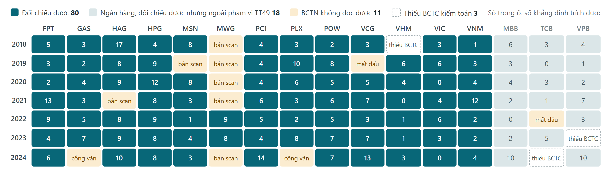
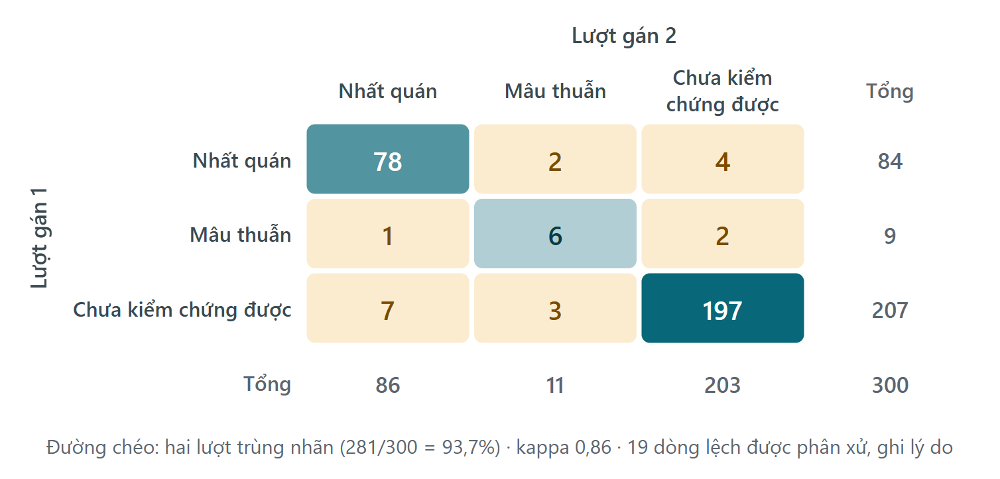

<!--
Mục 04 báo cáo Vòng 2 (mẫu BTC: "04 / TIÊU CHÍ 2 — 15%"). Bản cắt 19/11/2026, Nguyên chốt.
Giới hạn: ≤ 550 từ ngoài bảng + 1 bảng. ⟦CHỜ: …⟧ = số chưa đo. Quyết định nghiệp vụ: docs/gan-nhan/quyet-dinh-nghiep-vu.md.
-->

# 2. Chất lượng dữ liệu và cách tiếp cận dữ liệu | Trọng số 15%

## 2.1. Nguồn dữ liệu, quyền sử dụng và phạm vi

- **Số liệu:** TiniX OCR Annual Financials (HuggingFace `tinixai/ocr_annual_financials`, 18.231 BCTC, CC BY-NC 4.0), bảng HTML giữ cột Mã số TT200; đội dùng 338 BCTC hợp nhất và riêng của 16 mã.
- **Ngôn từ:** 112 BCTN (16 mã × 7 năm, 2018–2024) công bố bắt buộc theo Thông tư 96/2020/TT-BTC, tải qua Vietstock; repo không phân phối lại PDF, chỉ giữ script tải.

Hai nguồn độc lập, công khai, không có dữ liệu cá nhân. Hồ sơ Vòng 1 dự kiến lấy BCTN từ bộ Zenodo; đội chuyển sang tải theo mã từ Vietstock vì bộ Zenodo đóng gói theo giai đoạn, không tải lẻ theo mã được (riêng gói 2021–2025 đã 56,58 GB).

## 2.2. Tiền xử lý và chất lượng dữ liệu

**Bảng 2.1. Các bước xử lý dữ liệu, trước và sau**

| Bước | Vào → ra | Loại bỏ · lý do |
|---|---|---|
| Bóc bảng BCTC theo Mã số | 338 → 337 | Ontology 31 khoản mục |
| Ghép BCTC hợp nhất cùng năm | 112 → 109 | 3 thiếu BCTC hợp nhất (TCB 2024, VHM 2018, VPB 2023) |
| Bóc chữ BCTN, tách cột | 109 → **98 cặp** | 11 không dùng được: 7 bản scan, 2 mất dấu tiếng Việt (TCB 2022, VCG 2019), 2 là công văn (GAS, PLX 2024); lỗi hình học PDF đã vá |
| Trích, đối chiếu | 98 cặp → 511 khẳng định | 52 cần xem xét · 108 nhất quán · 351 chưa kiểm chứng (bản 21/09 trên 66 cặp: 695 khẳng định; 141 · 155 · 399) |

**Kiểm soát chất lượng:** đơn vị tính đọc theo từng bảng vì có thể đổi theo năm (VIC 2018 ghi đồng, 2020–2024 triệu đồng); đọc trang bìa 66 cặp của bản 21/09 thấy 1 cặp ghép nhầm BCTC riêng (VCG 2018), sẽ thay bằng BCTC hợp nhất ở bản tiếp theo. Các nguồn cờ oan khác: Bảng 1.1.

**Gán nhãn:** 300 cặp phân tầng (toàn bộ 141 cờ "cần xem xét" của bản 21/09, 159 cặp ngẫu nhiên phân bổ theo phán quyết; bỏ ngân hàng). Hai lượt gán độc lập đồng thuận 93,7%, **Cohen's kappa 0,86** (tính trước phân xử); 19/300 dòng bất đồng được phân xử theo hướng dẫn, ghi lý do từng dòng (Hình 2.2). Kết quả: 7 mâu thuẫn thật · 84 nhất quán · 209 chưa kiểm chứng được. Đây là **nhãn bạc**: gán theo hướng dẫn của đội, chưa qua kiểm toán viên hành nghề xác nhận.

## 2.3. Tính đại diện và nguy cơ quá khớp

**Đại diện:** 13 mã phi tài chính (3 ngân hàng chỉ đo vùng mù) thuộc 8 nhóm hoạt động chính do đội tự phân (thực phẩm, công nghệ, dầu khí và điện, thép, bán lẻ, bất động sản, xây lắp, nông nghiệp); bảy năm 2018–2024, gồm năm Covid và năm thoái vốn.

**Chống quá khớp:** mẫu chia **dev 102 / test 198 theo cặp (DN, năm)**, không theo câu, vì câu lặp trong cùng báo cáo (VNM 2021 tr.4 và tr.9). Đội đo thêm trên **tập chèn lỗi có kiểm soát** (mục 3.4): đáp án biết trước và độc lập với quá trình xây dựng bộ luật.

## 2.4. Đặc trưng / tăng cường dữ liệu

**Đặc trưng:** Mã số TT200 qua ontology (tra cứu tất định); 5 tỷ số suy ra; hướng, mốc so sánh, kỳ, đơn vị; bộ lọc phạm vi, tương lai, bên thứ ba.

**Không tăng cường dữ liệu để huấn luyện:** hệ thống dùng luật, không học từ dữ liệu; câu tổng hợp chỉ dùng **để đo** (tập chèn lỗi, 791 câu từ câu thật) và luôn báo cáo tách riêng. Nhãn thí nghiệm QKA sinh tự động từ bảng có Mã số: 1.945 dòng, 282 tên khác nhau, 8 Mã số.

## Minh chứng chất lượng dữ liệu

