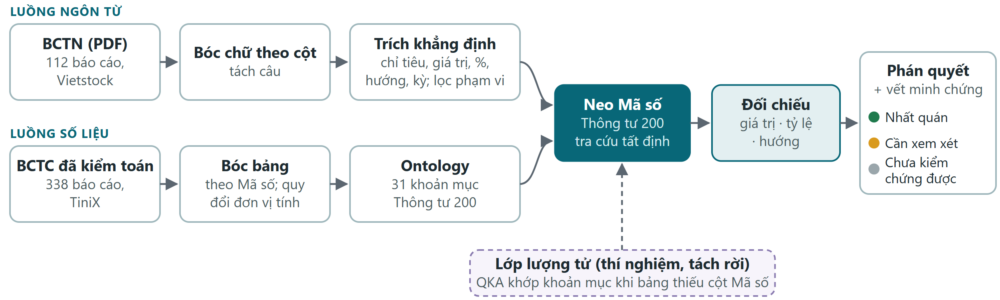

# 05 / Tiêu chí 3 — Tính hợp lý của giải pháp, thuật toán, phương pháp xử lý

### 3.1. Thiết kế tổng quan và sơ đồ luồng xử lý

Mã nguồn: `smartaudit/ingest`, `nlp/claims.py`, `tables/parser.py`, `nnc/checker.py`; lớp lượng tử tách rời ở `smartaudit/quantum`.

### 3.2. Phương pháp và lý do lựa chọn

- **Neo bằng Mã số, không neo bằng tên.** TT200 gán mỗi khoản mục một mã cố định; bộ TiniX giữ nguyên cột Mã số khi OCR. Liên kết khẳng định – minh chứng vì thế là tra cứu tất định, kiểm tra lại được bằng tay.
- **Trích khẳng định bằng bộ luật** (biểu thức chính quy + từ điển chỉ tiêu, xu hướng, phạm vi). Đây là lựa chọn có chủ đích: chạy ổn định, giải thích được từng quyết định, đo được — đúng tinh thần Điều 10 Thể lệ. Bộ luật là đường cơ sở để mô hình học (PhoBERT) phải thắng sau này.
- **"Thà im lặng có lý do còn hơn cáo buộc sai."** Ba phán quyết: Nhất quán · Cần xem xét · Chưa kiểm chứng được (kèm lý do: lệch phạm vi, chuỗi đứt gãy, không tra được chỉ tiêu).
- **Lượng tử ở đúng chỗ có dữ liệu:** QKA cho bài toán khớp khoản mục khi bảng thiếu cột Mã số (nhãn sinh tự động từ bảng có Mã số); QSVM phát hiện bất thường bị hoãn vì chỉ có 31 mẫu dương.

### 3.3. Thuật toán, cấu hình và giả định

**Bảng 3.1. Tham số chính của bộ đối chiếu**

| Tham số | Giá trị | Lý do |
|---|---|---|
| Dung sai giá trị | max(1%, sai số làm tròn của số trong câu) | "1,9 tỷ" khớp 1,94 tỷ |
| Lệch quá 50% | không kết luận (lệch phạm vi) | thường là số công ty con/mảng |
| Biến động kỳ > 40% | không so xu hướng (chuỗi đứt gãy) | thoái vốn, đổi phạm vi hợp nhất |
| Dung sai tỷ lệ % | 1 điểm phần trăm | "tăng 2,3%" vs +2,34% |
| "Kiểm soát chi phí" | tỷ lệ chi phí/doanh thu tăng ≤ 2 điểm | quy định tính về định lượng |
| "Doanh thu" | Mã 10, hoặc Mã 01, hoặc 10 + 21 + 31 | ba định nghĩa kế toán hợp lệ |

Mỗi nguyên nhân cờ oan ở Bảng 1.1 được vá kèm test hồi quy: **⟦CHỜ: số test⟧ phép kiểm tự động**.

### 3.4. Kết quả chạy thử và so sánh cơ bản

**Bảng 3.2. Kết quả chạy thử, so với bản 21/09** *(ví dụ đầu ra: Hình 1.1)*

| Chỉ số | Bản 21/09 | Hiện tại (20/11) | Ghi chú |
|---|---|---|---|
| Khẳng định trích được | 695 | 511 | 66 → 98 báo cáo, 16 mã |
| Cờ "cần xem xét" | 141 | 52 | 31 cờ nằm ngoài mẫu đã gán nhãn |
| Precision nhóm cần xem xét (mẫu 300 cặp, nhãn bạc) | 2,8% (4/141) | 0% (0/21) | KTC 95%: 1,1–7,1% / 0–15,5% |
| Cờ oan ước tính trên tập khẳng định bản 21/09 | ~137 | ~23 | giảm ~83% |
| Recall trên tập chèn lỗi (dữ liệu tổng hợp) | — | 83,0% (473/570) | đổi giá trị ≥ 10%: 89–98% |
| Báo động giả trên câu đối chứng | — | 0/163 | câu gốc + câu lệch 0,5% |
| QKA khớp khoản mục: QSVM+QKA / SVM-RBF / rapidfuzz | — | 0,840 / 0,911 / 0,812 | accuracy, 5 phần, 8 qubit |

Đọc kết quả: bộ đối chiếu nhạy với lỗi khi câu được trích đúng (tập chèn lỗi), và bản vá loại được phần lớn cờ oan. Trên dữ liệu thật, mâu thuẫn thật rất hiếm (ước tính 2,1% khẳng định) và đều nằm ở tỷ số, cơ cấu — loại hệ thống chưa tính — nên precision chưa đạt mục tiêu 80% đã đặt ở Vòng 1.

### Giới hạn của giải pháp và điều kiện áp dụng

- **Trường hợp chưa đạt:** khẳng định về tỷ số cơ cấu (Nợ/VCSH, tỷ trọng tài sản) và câu nói về một mảng, công ty con mà không có từ chỉ phạm vi. Hệ thống trả "chưa kiểm chứng được" hoặc gắn "cần xem xét" để người rà, không tự kết luận sai phạm.
- **Giả định ảnh hưởng kết quả:** BCTC hợp nhất đã kiểm toán là chuẩn đúng; câu không ghi phạm vi được hiểu là số hợp nhất; dung sai giá trị 1% và tỷ lệ 1 điểm phần trăm (Bảng 3.1).
- **Điều kiện áp dụng:** BCTC lập theo Thông tư 200 và báo cáo thường niên có lớp chữ (PDF bóc được văn bản).
- **Hướng phát triển ở vòng tới:** mở rộng sang BCTC ngân hàng theo Thông tư 49 (ánh xạ Mã số của biểu mẫu ngân hàng vào ontology) và báo cáo thường niên bản scan (thêm bước OCR trước khi trích khẳng định).
